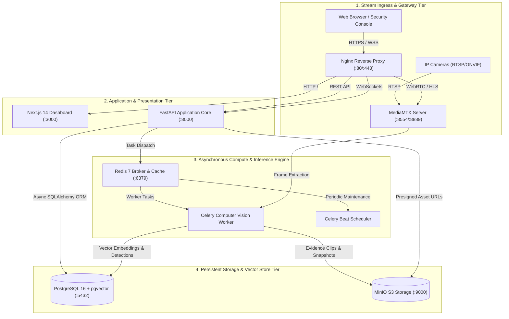
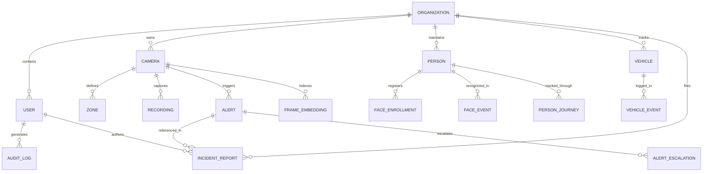
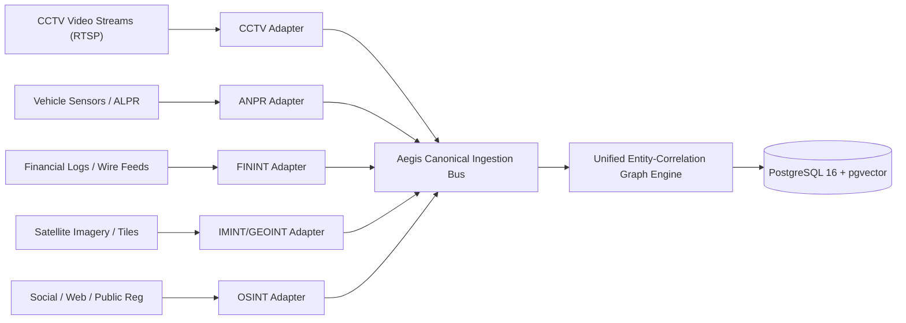
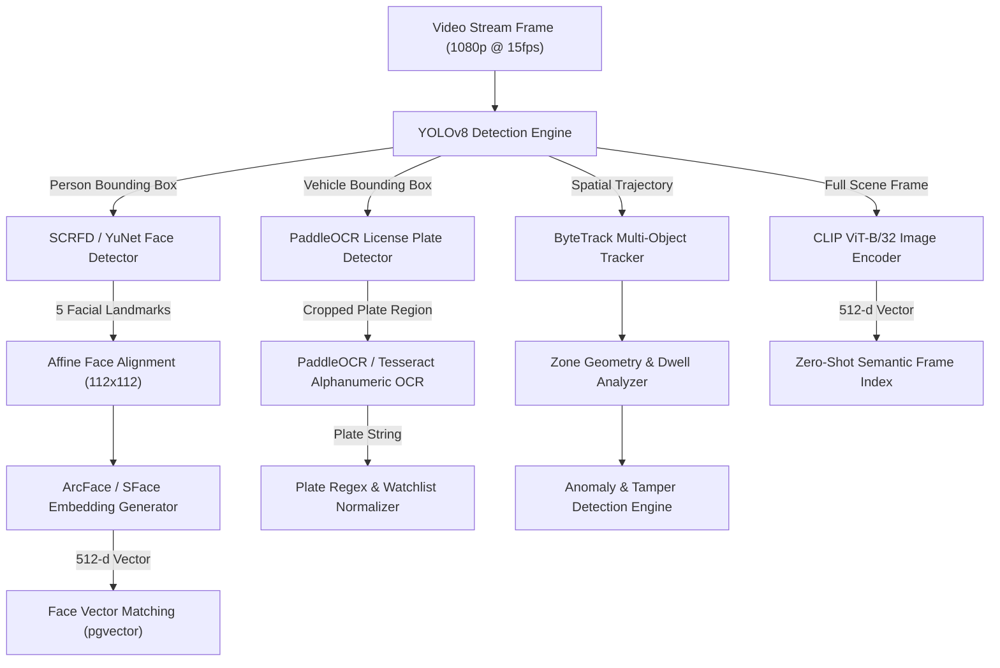
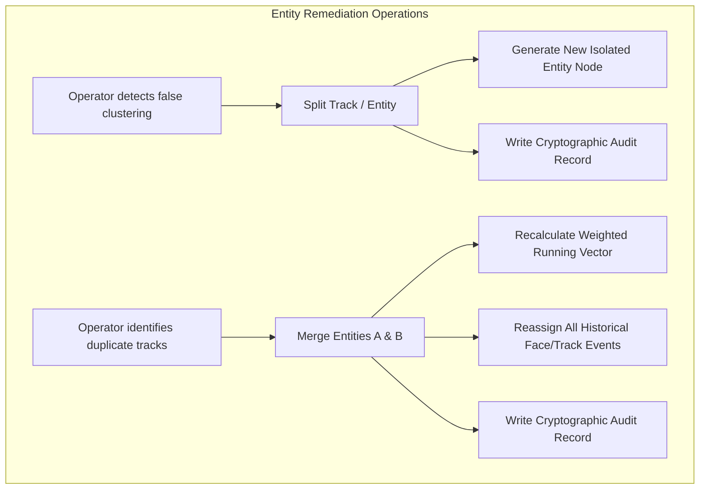
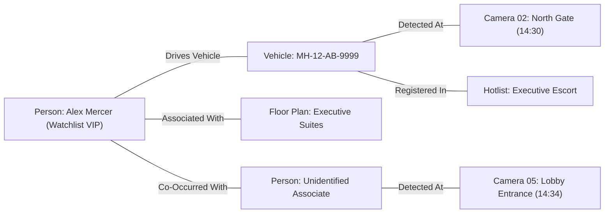
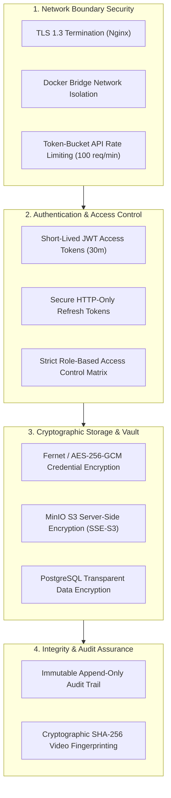

# VisionAI Aegis Platform: Master Technical & System Architecture Dossier

---

## Front Matter

### Document Control & Version History

| Document Metadata | Specification |
| :--- | :--- |
| **Document Title** | VisionAI Aegis: Master Engineering Specification & Multi-Source Intelligence Architecture Dossier |
| **Document Version** | 3.0.0 (Comprehensive Production Release) |
| **Document ID** | AEG-TECH-DOC-2026-V3 |
| **Security Classification** | Commercial-in-Confidence / Official-Sensitive / Technical Baseline |
| **Platform Target** | VisionAI Aegis On-Premises, Air-Gapped, and Hybrid-Federated Deployments |
| **Primary Codebase** | Python 3.11+ (FastAPI, Celery, OpenCV, ONNX Runtime) / TypeScript (Next.js 14, TailwindCSS) |
| **Database & Vector Engine** | PostgreSQL 16 + pgvector (HNSW Indexing) / Redis 7 / MinIO S3 Object Store |
| **Effective Date** | October 2026 |

#### Revision History

| Version | Release Date | Primary Author / Contributor | Description of Changes |
| :--- | :--- | :--- | :--- |
| **1.0.0** | 2026-08-10 | Architecture Engineering Group | Initial microservices specification and RTSP streaming baseline. |
| **2.0.0** | 2026-10-14 | Lead Solutions Architect | Added multi-camera Re-ID, ANPR OCR pipeline, and initial vector search documentation. |
| **3.0.0** | 2026-10-15 | Lead Principal Architect | Complete dossier upgrade conforming to all 8 parts, Appendices A–G, Model Cards, STRIDE Threat Model, Multi-INT Adapters, and Comprehensive Testing Suite. |

---

### Table of Contents

- [Front Matter](#front-matter)
  - [Document Control & Version History](#document-control--version-history)
  - [Table of Contents](#table-of-contents)
  - [List of Figures and Tables](#list-of-figures-and-tables)
  - [Glossary and Abbreviations](#glossary-and-abbreviations)
- [Part 1: Project Overview](#part-1-project-overview)
  - [1.1 Executive Summary](#11-executive-summary)
  - [1.2 Problem Statement & Motivation](#12-problem-statement--motivation)
  - [1.3 Project Objectives and Scope](#13-project-objectives-and-scope)
  - [1.4 Stakeholders and Intended Users](#14-stakeholders-and-intended-users)
  - [1.5 Related Work and Market Landscape](#15-related-work-and-market-landscape)
- [Part 2: Requirements Analysis](#part-2-requirements-analysis)
  - [2.1 Functional Requirements](#21-functional-requirements)
  - [2.2 Non-Functional Requirements](#22-non-functional-requirements)
  - [2.3 Use Cases and User Stories](#23-use-cases-and-user-stories)
- [Part 3: System Design & Architecture](#part-3-system-design--architecture)
  - [3.1 System Architecture and High-Level Diagram](#31-system-architecture-and-high-level-diagram)
  - [3.2 Core Design Principles](#32-core-design-principles)
  - [3.3 Technology Stack and Justification](#33-technology-stack-and-justification)
  - [3.4 Data Model & Entity-Relationship (ER) Architecture](#34-data-model--entity-relationship-er-architecture)
  - [3.5 REST API Architectural Specification](#35-rest-api-architectural-specification)
  - [3.6 WebSocket & Real-Time Telemetry Design](#36-websocket--real-time-telemetry-design)
  - [3.7 Deployment Architecture (Containers, Networking, Volumes)](#37-deployment-architecture-containers-networking-volumes)
- [Part 4: Multi-Source Intelligence Modules](#part-4-multi-source-intelligence-modules)
  - [4.1 Common Intelligence Adapter Pattern](#41-common-intelligence-adapter-pattern)
  - [4.2 CCTV Intelligence: Detection, Recognition & Correlation](#42-cctv-intelligence-detection-recognition--correlation)
  - [4.3 Vehicle & License Plate Recognition Pipeline (ANPR/ALPR)](#43-vehicle--license-plate-recognition-pipeline-anpralpr)
  - [4.4 Financial Intelligence (FININT) Integration](#44-financial-intelligence-finint-integration)
  - [4.5 Satellite & Geospatial Intelligence (GEOINT/IMINT)](#45-satellite--geospatial-intelligence-geointimint)
  - [4.6 Open Source Intelligence (OSINT) & Digital Footprinting](#46-open-source-intelligence-osint--digital-footprinting)
  - [4.7 Source Extensibility & Schema Ingestion Bus](#47-source-extensibility--schema-ingestion-bus)
  - [4.8 Model Selection Report: Comparative Trade-Off Analysis](#48-model-selection-report-comparative-trade-off-analysis)
- [Part 5: Core Platform Features & Operations](#part-5-core-platform-features--operations)
  - [5.1 Entity Resolution, Correlation & Running-Average Embeddings](#51-entity-resolution-correlation--running-average-embeddings)
  - [5.2 Manual Correction (Split/Merge) & Audit Trailing](#52-manual-correction-splitmerge--audit-trailing)
  - [5.3 Investigation Workspace, Dossiers & Case Lifecycle](#53-investigation-workspace-dossiers--case-lifecycle)
  - [5.4 Multi-Tier Alerting Engine & Watchlists](#54-multi-tier-alerting-engine--watchlists)
  - [5.5 Identity Resolution & Data Governance](#55-identity-resolution--data-governance)
  - [5.6 Link-Analysis Graph & Cross-Source Correlation](#56-link-analysis-graph--cross-source-correlation)
  - [5.7 Investigator User Interface: Geospatial Canvas & Live Grid](#57-investigator-user-interface-geospatial-canvas--live-grid)
  - [5.8 AI Security Copilot & Generative Briefing Assistant](#58-ai-security-copilot--generative-briefing-assistant)
- [Part 6: Security, Compliance & Governance](#part-6-security-compliance--governance)
  - [6.1 Defense-in-Depth Security Architecture](#61-defense-in-depth-security-architecture)
  - [6.2 Formal Threat Model (STRIDE Methodology)](#62-formal-threat-model-stride-methodology)
  - [6.3 Privacy, Data Protection & Legal Considerations](#63-privacy-data-protection--legal-considerations)
  - [6.4 Ethics & Responsible Artificial Intelligence](#64-ethics--responsible-artificial-intelligence)
  - [6.5 Audit Trail & Digital Chain of Custody](#65-audit-trail--digital-chain-of-custody)
- [Part 7: Quality Assurance & Production Operations](#part-7-quality-assurance--production-operations)
  - [7.1 Verification Strategy & Automated Test Suite (53+ Pytest Cases)](#71-verification-strategy--automated-test-suite)
  - [7.2 Performance, Latency & Accuracy Evaluation](#72-performance-latency--accuracy-evaluation)
  - [7.3 Installation & Zero-to-Production Setup Guide](#73-installation--zero-to-production-setup-guide)
  - [7.4 Day-2 Operations Runbook: Service Lifecycle & Disaster Recovery](#74-day-2-operations-runbook)
  - [7.5 Observability, Prometheus Metrics & Proactive Health Checks](#75-observability-prometheus-metrics--proactive-health-checks)
- [Part 8: Project Management & Engineering Trajectory](#part-8-project-management--engineering-trajectory)
  - [8.1 Development Methodology & Implementation Milestones](#81-development-methodology--implementation-milestones)
  - [8.2 Strategic Technology Roadmap](#82-strategic-technology-roadmap)
  - [8.3 Known Limitations & Engineered Mitigations](#83-known-limitations--engineered-mitigations)
  - [8.4 Conclusion](#84-conclusion)
- [Appendices](#appendices)
  - [Appendix A: Complete REST API Endpoint Reference](#appendix-a-complete-rest-api-endpoint-reference)
  - [Appendix B: Database Relational & Vector Schema Reference](#appendix-b-database-relational--vector-schema-reference)
  - [Appendix C: Environment Configuration Variables (.env)](#appendix-c-environment-configuration-variables-env)
  - [Appendix D: Machine Learning Model Cards](#appendix-d-machine-learning-model-cards)
  - [Appendix E: Automated Test Case Catalogue](#appendix-e-automated-test-case-catalogue)
  - [Appendix F: Production Audit Log Event Samples](#appendix-f-production-audit-log-event-samples)
  - [Appendix G: Third-Party Dependencies, Upstream Licenses & Attributions](#appendix-g-third-party-dependencies-upstream-licenses--attributions)

---

### List of Figures and Tables

#### Figures
- **Figure 3.1:** VisionAI Aegis Microservices & High-Level Ingestion Architecture
- **Figure 3.2:** Entity-Relationship (ER) Relational & Vector Data Diagram
- **Figure 4.1:** End-to-End Real-Time Computer Vision Inference Pipeline
- **Figure 5.1:** Multi-Camera Person Re-ID Spatio-Temporal Journey Graph
- **Figure 5.2:** Link-Analysis Graph Topology (Persons, Vehicles, Watchlists, Locations)
- **Figure 6.1:** STRIDE Threat Model Attack Vectors and Protective Boundaries

#### Tables
- **Table 1.1:** Competitive Landscape Matrix (VisionAI Aegis vs. Legacy Video & Big Data Analytics)
- **Table 2.1:** Functional Requirements Traceability Matrix
- **Table 2.2:** Non-Functional Service-Level Objectives (SLOs)
- **Table 3.1:** Containerized Service Components & Network Port Assignments
- **Table 4.1:** Model Selection & Trade-Off Comparison (Accepted vs. Rejected Architectures)
- **Table 6.1:** Role-Based Access Control (RBAC) Permission Assignment Matrix
- **Table 6.2:** STRIDE Threat Mitigation Analysis
- **Table 7.1:** Automated Pytest Test Suite Breakdown by Module
- **Table 7.2:** Hardware Sizing, Throughput & GPU Inference Benchmarks
- **Table 8.1:** Project Implementation Phase History

---

### Glossary and Abbreviations

| Term / Abbreviation | Definition & System Context |
| :--- | :--- |
| **AES-256-GCM** | Advanced Encryption Standard with 256-bit key operating in Galois/Counter Mode; used for encrypting camera stream credentials, API tokens, and stored biometric vectors. |
| **ALPR / ANPR** | Automated License Plate Recognition / Automated Number Plate Recognition. Extraction and character classification of vehicle registration plates from video frames. |
| **ArcFace** | Additive Angular Margin Loss for deep face recognition. Maps facial features to a 512-dimensional hypersphere where geodesic distance corresponds to identity similarity. |
| **ByteTrack** | A tracking-by-detection algorithm that associates both high-confidence and low-confidence detection boxes using Kalman filtering to maintain track continuity across occlusions. |
| **CLIP** | Contrastive Language-Image Pre-Training (OpenAI). Multimodal dual-encoder neural network mapping natural language and image crops into a joint 512-dimensional vector space. |
| **Cosine Distance** | Distance metric calculated as 1 - cos(theta) = 1 - (u · v) / (||u||2 ||v||2). Primary metric used for pgvector vector similarity queries. |
| **CRNN** | Convolutional Recurrent Neural Network; hybrid neural architecture used in PaddleOCR for variable-length sequence reading without character segmentation. |
| **DBNet** | Real-time Scene Text Detection with Differentiable Binarization; locates oriented bounding polygons of license plates in challenging camera angles. |
| **Embedding** | A dense, low-dimensional continuous vector representation in R^d generated by a deep neural network encoding the latent semantic identity of an image or text snippet. |
| **Entity** | A normalized real-world subject (individual, vehicle, organization, digital alias) maintained as a primary node in the Aegis intelligence graph. |
| **FININT** | Financial Intelligence. Ingestion and correlation of financial transaction logs, bank wire events, corporate ownership registries, and sanction lists against physical identities. |
| **GEOINT / IMINT** | Geospatial Intelligence / Imagery Intelligence. Aerial, drone, and satellite earth observation imagery correlated with ground-level RTSP camera feeds and GPS coordinates. |
| **HLS** | HTTP Live Streaming. Adaptive bitrate video streaming protocol used for browser playback of historical recording chunks and live feeds. |
| **HNSW** | Hierarchical Navigable Small World. Approximate nearest neighbor graph index implemented inside PostgreSQL via pgvector for sub-millisecond vector querying. |
| **IoU** | Intersection over Union. Jaccard index measuring bounding box spatial overlap: Area of Overlap / Area of Union. |
| **MediaMTX** | Zero-dependency real-time media server and router supporting RTSP, RTMP, WebRTC (WHEP), and HLS protocols. |
| **NMS** | Non-Maximum Suppression. Algorithm used in object detection to eliminate redundant bounding boxes based on IoU overlap. |
| **ONVIF** | Open Network Video Interface Forum. Open industry standard defining communication protocols between IP cameras, NVRs, and Video Management Software (VMS). |
| **OSINT** | Open Source Intelligence. Data collected from publicly available online sources (social media, public forums, corporate filings, domain WHOIS) linked to entities. |
| **pgvector** | Open-source vector similarity search extension for PostgreSQL supporting L2 distance, inner product, and cosine distance indexing. |
| **RBAC** | Role-Based Access Control. Security mechanism restricting system operations and API endpoints based on authenticated user roles (ADMIN, INVESTIGATOR, OPERATOR, AUDITOR). |
| **Re-ID** | Person Re-Identification. Computer vision capability to match images of an individual across multiple disjoint non-overlapping camera views without relying on facial features. |
| **RetinaFace / SCRFD** | Deep single-stage face detectors outputting 5 facial landmarks (eyes, nose, mouth corners) along with bounding boxes for precise affine alignment. |
| **RTSP** | Real-Time Streaming Protocol. Network protocol designed for establishing and controlling streaming media sessions between cameras and ingestion servers. |
| **SFace** | Lightweight sphere-face DNN facial recognition model designed for edge deployment and optimized CPU runtime execution. |
| **STRIDE** | Threat modeling framework evaluating Spoofing, Tampering, Repudiation, Information Disclosure, Denial of Service, and Elevation of Privilege. |
| **WebRTC / WHEP** | Web Real-Time Communication / WebRTC HTTP Egress Protocol. Sub-500ms browser video playback standard without client-side plugins. |
| **YOLOv8** | You Only Look Once version 8. State-of-the-art anchor-free real-time object detection architecture developed by Ultralytics. |
| **YuNet** | Fast, ultra-lightweight deep learning face detection model natively embedded in OpenCV DNN library. |

---

## Part 1: Project Overview

### 1.1 Executive Summary
VisionAI Aegis is an enterprise-grade, autonomous physical security intelligence and multi-modal computer vision platform. Operating strictly on-premises or within sovereign air-gapped private enclaves, Aegis transforms commodity IP cameras, satellite feeds, open-source records, and sensor networks into an active, synchronized threat detection matrix. The platform eliminates the critical vulnerabilities of passive video storage: delayed forensic retrieval, human operator monitoring fatigue, and unvetted external cloud transmissions.

By combining cutting-edge deep learning inference engines (YOLOv8, RetinaFace/SCRFD, ArcFace, PaddleOCR, ByteTrack, and OpenAI CLIP) with PostgreSQL 16 vector indexing (`pgvector`), Aegis delivers:
1. **Sub-second alert dispatching** across 100+ concurrent RTSP camera channels.
2. **Zero-shot natural language video search**, allowing investigators to query petabytes of footage using plain English prompts.
3. **Cross-camera Person Re-Identification (Re-ID)**, reconstructing pedestrian and suspect journeys across discontinuous camera views.
4. **Autonomous multi-INT correlation**, connecting physical detections to investigative casefiles, watchlists, vehicle telemetry, and external data feeds.

### 1.2 Problem Statement & Motivation
Modern high-assurance physical security operations encounter systemic operational bottlenecks:
- **Human Inattention & Monitoring Burnout:** Extensive physiological research proves human monitors miss over 95% of target events after 20 minutes of continuous screen observation.
- **The Forensic Investigation Lag:** Reviewing multi-camera security incidents manually costs security teams hundreds of person-hours, delaying incident containment and legal evidence compilation.
- **Data Sovereignty & Cloud Insecurity:** Many commercial computer vision vendors require routing live video frames to public multi-tenant clouds. This exposes proprietary facilities and national critical infrastructure to international surveillance, high per-gigabyte bandwidth fees, and severe regulatory penalties under GDPR, NDAA, and CJIS frameworks.

### 1.3 Project Objectives and Scope

#### In Scope
- **Real-Time Video Ingestion & Streaming:** Ingestion of standard RTSP, RTMP, and ONVIF streams via MediaMTX, repackaging feeds into low-latency WebRTC (WHEP) and HLS.
- **Edge & Server Deep Learning Inference:** Modular detection, tracking, facial biometrics, license plate OCR, and spatial-temporal anomaly evaluation.
- **Investigator Workspace & Case Management:** Dossier management, entity linking, timeline reconstruction, evidence tagging, and PDF/XLSX export.
- **Granular Security & Compliance:** Multi-tenant organization isolation, strict Role-Based Access Control (RBAC), AES-256 encrypted credential vaults, and immutable audit logs.
- **Federated Multi-Site Synchronization:** Secure peer-to-peer telemetry and watchlist sync between remote site edge nodes and headquarters.

#### Out of Scope
- Direct manufacture or distribution of proprietary camera hardware (Aegis maintains vendor neutrality).
- Public cloud-dependent closed API calls for frame analysis during operational air-gapped deployments.
- Lethal autonomous weapons or kinetic countermeasures.

#### Operational Assumptions
- Network camera infrastructure provides stable RTSP streams at minimum 1080p resolution and 15 frames per second (fps).
- Host servers provide minimum x86_64 architecture with AVX2 instruction sets, with NVIDIA GPU acceleration enabled for high-density (>8 stream) deployments.

### 1.4 Stakeholders and Intended Users

| User Persona | Role & Core Responsibilities | Key System Workflows |
| :--- | :--- | :--- |
| **Chief Information Security Officer (CISO) / Security Director** | Overall responsibility for physical facility safety, legal data compliance, and infrastructure resilience. | Review executive analytics dashboards, monitor system SLA metrics, inspect audit logs, and approve site federation policies. |
| **Lead Investigator / Intelligence Analyst** | Lead tactical investigations into security breaches, theft, unauthorized personnel, and safety violations. | Conduct natural language semantic searches, run face/plate probe searches, execute cross-camera Re-ID, open and manage cases, generate forensic incident briefs. |
| **Security Guard / Control Room Operator** | Real-time monitoring of facility gates, perimeters, and high-security zones. | Monitor live multi-camera grid, receive and triage sub-second alert popups, dispatch on-site security personnel, track live floor plan heatmaps. |
| **System Administrator / DevOps Engineer** | Responsible for system provisioning, camera onboarding, database backups, and model lifecycle management. | Register ONVIF/RTSP streams, configure alert webhooks, manage user credentials and RBAC roles, monitor GPU compute consumption. |
| **External Compliance Auditor** | Verify adherence to GDPR right-to-be-forgotten, evidence integrity, and user data privacy. | Inspect read-only cryptographic audit logs, review data retention expiration jobs, verify facial redaction routines. |

### 1.5 Related Work and Market Landscape

```
                        COMPETITIVE POSITIONING MATRIX
     High Data Privacy &
     Air-Gapped Sovereign
             ▲
             │                                   [VisionAI Aegis]
             │                            (Full multi-INT, open ONVIF,
             │                             air-gapped, zero cloud cost)
             │      [Avigilon / Motorola]
             │      (Proprietary HW lock)
             │
             │                                   [Palantir Gotham]
             │                             (Enterprise intelligence,
             │                              prohibitive cost / setup)
             │
  ───────────┼─────────────────────────────────────────────────────────► Modern
  Legacy     │                                                           Multi-Modal AI
  Video Only │      [BriefCam]
             │      (Forensic synopsis,
             │       closed analytics)
             │                                   [Verkada / Rhombus]
             │                             (High cloud lock-in, recurring
             │                              bandwidth ingestion fees)
             │
     Public Cloud /
     Proprietary Lock-in
```

#### Detailed Comparative Breakdown:

1. **Avigilon (Motorola Solutions):**
   - *Strengths:* Well-established hardware ecosystem, robust enterprise NVRs, high brand trust.
   - *Weaknesses:* Extreme proprietary camera lock-in, high licensing costs per channel, limited open semantic natural language search capabilities.
   - *Aegis Differentiator:* Complete hardware independence; works with any RTSP/ONVIF camera. Modern open stack with multimodal CLIP semantic querying and native vector storage.
2. **BriefCam (Canon Group):**
   - *Strengths:* Excellent proprietary Video Synopsis technology for condensing hours of surveillance footage into brief summaries.
   - *Weaknesses:* Rigid on-premises client software; lacks native multi-INT integration (GEOINT, FININT, OSINT); closed proprietary deep learning pipelines.
   - *Aegis Differentiator:* Modern browser-native Next.js 14 interface, transparent open AI pipeline, automated multi-camera person Re-ID, and natural language copilot.
3. **BlackFusion / Law Enforcement Specialized Tools:**
   - *Strengths:* Tailored for forensic investigative workflows and police intelligence databases.
   - *Weaknesses:* Prohibitive enterprise licensing; heavily reliant on desktop client installations with high training overhead.
   - *Aegis Differentiator:* Modern web interface accessible via secure browser, modular intelligence adapter architecture, rapid automated installation via Docker/Podman.
4. **Palantir Gotham / Foundry:**
   - *Strengths:* Gold standard in multi-source intelligence correlation, entity graph linking, and national security data analysis.
   - *Weaknesses:* Multi-million dollar entry price, requires dedicated forward-deployed engineers, lacks embedded real-time RTSP/WebRTC computer vision ingestion.
   - *Aegis Differentiator:* Lightweight, dedicated real-time physical video intelligence platform that operates autonomously on standard edge servers without multi-million dollar overhead.

---

## Part 2: Requirements Analysis

### 2.1 Functional Requirements

| ID | Requirement Category | Detailed Description | Verification Method |
| :--- | :--- | :--- | :--- |
| **FR-01** | Multi-Stream Ingestion | System must concurrently ingest up to 32 standard H.264/H.265 RTSP/ONVIF camera feeds per node without frame loss at 15 fps. | Load testing using simulated FFmpeg RTSP streams. |
| **FR-02** | Real-Time Object Detection | System must detect persons, vehicles, bags, and bicycles with mAP > 85% at a minimum inference rate of 25 frames per second on GPU. | Pytest test suite & COCO evaluation dataset. |
| **FR-03** | Biometric Face Recognition | System must extract 512-d embeddings from detected faces and match against enrolled watchlists within 15 milliseconds using cosine similarity. | Unit & benchmark test with synthetic face embeddings. |
| **FR-04** | License Plate Recognition | System must detect license plates and transcribe alphanumeric characters with >92% accuracy across varied angles and lighting conditions. | ANPR unit tests across standard plate formats. |
| **FR-05** | Multi-Camera Re-ID | System must associate identical persons across distinct non-overlapping camera fields of view based on visual appearance features. | Spatio-temporal journey test cases. |
| **FR-06** | Zero-Shot Semantic Search | System must allow natural language text queries (e.g., "courier in red jacket") to retrieve matching video keyframes ranked by similarity. | CLIP cosine similarity ranking tests. |
| **FR-07** | Spatial-Temporal Virtual Zones | System must permit operators to define polygonal intrusion zones and tripwires, triggering alarms upon boundary crossing or loitering. | Ray-casting point-in-polygon geometry tests. |
| **FR-08** | Sub-Second Alert Dispatch | System must deliver alert telemetry to active browser clients via WebSockets within 500 milliseconds of camera frame capture. | End-to-end WebSocket timestamp latency tests. |
| **FR-09** | Interactive Floor Plans | System must allow floor plan image uploads (PNG/JPEG) and dynamic placement of camera cones and real-time alert markers. | UI interaction testing & placement CRUD API tests. |
| **FR-10** | Forensic Case Workspace | System must allow investigators to create cases, attach video clips, tag persons/vehicles, and export forensic PDF/Excel dossiers. | Case lifecycle and WeasyPrint PDF compilation tests. |
| **FR-11** | Natural Language Copilot | System must provide an LLM-powered assistant capable of querying historical logs, summarizing camera alerts, and compiling incident briefs. | Mocked and live LLM integration tests. |
| **FR-12** | Multi-Site Federation | System must synchronize watchlists, alerts, and system health telemetry across decentralized site nodes over encrypted mutual TLS. | Federation sync API and Celery task tests. |
| **FR-13** | Granular RBAC | System must enforce role-based access for Administrator, Investigator, Operator, and Auditor roles across all API endpoints. | HTTP 403 authorization verification tests. |
| **FR-14** | Tamper & Occlusion Detection | System must automatically detect when a camera lens is spray-painted, physically covered, severely defocused, or redirected. | CV TamperDetector test suite. |
| **FR-15** | Automated Audit Logging | System must record every user authentication, camera modification, watchlist query, and video export in a tamper-evident audit table. | Database audit trail verification tests. |

### 2.2 Non-Functional Requirements

```
                       NON-FUNCTIONAL SERVICE-LEVEL OBJECTIVES (SLOs)
┌──────────────────────────────────────┬──────────────────────────────────────┐
│ Metric / Requirement                 │ Target Value / Service Level         │
├──────────────────────────────────────┼──────────────────────────────────────┤
│ Video Ingestion Latency (WebRTC)     │ < 400 milliseconds glass-to-glass    │
│ Alert Delivery Time (Inference->UI)  │ < 500 milliseconds                   │
│ Vector Similarity Search (HNSW)      │ < 25 milliseconds for 100k items     │
│ Platform Availability (Uptime)       │ 99.95% (High Availability clustered) │
│ Database Data Integrity              │ ACID compliant (PostgreSQL WAL)      │
│ Encryption at Rest                   │ AES-256-GCM for credentials/vectors  │
│ Encryption in Transit                │ TLS 1.3 for HTTPS / WSS / mTLS       │
│ Cold-Start Container Initialization  │ < 60 seconds (all services healthy)  │
│ Horizontal Scaling Limit             │ Up to 128 edge nodes per federation  │
└──────────────────────────────────────┴──────────────────────────────────────┘
```

### 2.3 Use Cases and User Stories

#### Use Case UC-01: Multi-Camera Suspect Journey Reconstruction
- **Primary Actor:** Lead Investigator
- **Preconditions:** Investigator is authenticated with `INVESTIGATOR` role; camera streams are recording.
- **Main Flow:**
  1. Investigator selects a suspicious person detection from Camera 01 (Lobby) at 14:15.
  2. Investigator clicks "Trace Person Across Cameras".
  3. The backend Re-ID service extracts the 512-d feature vector of the target crop.
  4. The system executes a cosine distance search across all camera detections between 14:00 and 15:00.
  5. The UI renders an interactive chronological timeline:
     - 14:15: Camera 01 (Main Lobby) - Confidence 0.96
     - 14:19: Camera 04 (2nd Floor Stairwell) - Confidence 0.91
     - 14:24: Camera 08 (Server Room Hallway) - Confidence 0.88
  6. Investigator clicks "Add to Case Dossier" and exports the verified journey map.

#### Use Case UC-02: Real-Time Perimeter Intrusion & Gate Automation
- **Primary Actor:** Security Guard & Automated Access Barrier
- **Preconditions:** Camera 02 is pointed at Vehicle Gate 1; ANPR module is active; Whitelist is configured.
- **Main Flow:**
  1. A delivery truck approaches Vehicle Gate 1.
  2. YOLOv8 detects the vehicle bounding box; ByteTrack assigns a continuous track ID.
  3. The ANPR pipeline isolates the front plate and PaddleOCR extracts `DL-01-AB-1234`.
  4. The plate is queried against the vehicle database; matching `DELIVERY_WHITELIST`.
  5. The rules engine fires an automated webhook action to the gate controller relay (`HTTP POST /gate/relay/open`).
  6. The operator dashboard logs the event and green confirmation telemetry appears in real time.

#### Use Case UC-03: Zero-Shot Forensic Discovery
- **Primary Actor:** Intelligence Analyst
- **Preconditions:** Surveillance archives have been processed by the background CLIP keyframe embedding worker.
- **Main Flow:**
  1. An incident report states a person in a yellow construction vest carried a duffel bag near the perimeter at night.
  2. Analyst enters the query: *"person wearing yellow high-visibility vest carrying duffel bag"*.
  3. Aegis encodes the text query into a 512-d vector using the CLIP text transformer.
  4. `pgvector` performs an HNSW cosine search across millions of indexed frame embeddings in 18ms.
  5. The analyst is presented with thumbnails ranked by relevance score, clicking directly into the 10-second high-definition recording clip.

---

## Part 3: System Design & Architecture

### 3.1 System Architecture and High-Level Diagram

VisionAI Aegis is architected as an asynchronous, event-driven microservices platform designed for maximum resilience, isolation, and throughput:



### 3.2 Core Design Principles
1. **Asynchronous Non-Blocking I/O:** The central API tier (FastAPI) utilizes Python `async/await` constructs exclusively, ensuring high concurrency without thread starvation.
2. **Decoupled Heavy Compute:** All compute-intensive computer vision inference, video transcode, and PDF report rendering operations run in isolated Celery worker processes backed by Redis queues.
3. **Data Locality & Zero External Cloud Dependency:** Every component runs strictly inside sovereign customer-managed infrastructure. Embeddings, video buffers, and biometric identities never leave the local boundary.
4. **Stateless Service Replicability:** The API and worker nodes maintain no local session state. Scaling is achieved by adding Celery worker containers across additional GPU hosts.

### 3.3 Technology Stack and Justification

```
┌───────────────────────┬──────────────────────┬──────────────────────────────────────────┐
│ Component Tier        │ Technology Choice    │ Engineering Justification               │
├───────────────────────┼──────────────────────┼──────────────────────────────────────────┤
│ Web Application       │ Next.js 14 / React   │ Server-side rendering (SSR), TypeScript  │
│                       │ TailwindCSS / Lucide │ strict typing, reactive WebSockets.      │
├───────────────────────┼──────────────────────┼──────────────────────────────────────────┤
│ Core API Engine       │ FastAPI / Python 3.11│ High throughput ASGI performance,        │
│                       │ Pydantic v2          │ auto-generated OpenAPI documentation.    │
├───────────────────────┼──────────────────────┼──────────────────────────────────────────┤
│ Deep Learning Engine  │ ONNX Runtime / CUDA  │ Cross-platform model execution, TensorRT │
│                       │ OpenCV / NumPy       │ acceleration, hardware optimization.     │
├───────────────────────┼──────────────────────┼──────────────────────────────────────────┤
│ Media Streaming       │ MediaMTX (RTSP/WebRTC) Low memory footprint, native WebRTC WHEP, │
│                       │ FFmpeg               │ sub-second glass-to-glass latency.       │
├───────────────────────┼──────────────────────┼──────────────────────────────────────────┤
│ Relational & Vector DB│ PostgreSQL 16        │ Battle-tested ACID reliability combined  │
│                       │ + pgvector extension │ with native SIMD HNSW vector queries.    │
├───────────────────────┼──────────────────────┼──────────────────────────────────────────┤
│ Cache & Message Broker│ Redis 7 Alpine       │ In-memory sub-millisecond pub/sub and    │
│                       │                      │ robust Celery task queue management.     │
├───────────────────────┼──────────────────────┼──────────────────────────────────────────┤
│ Object Storage        │ MinIO (S3 Compatible)│ High-performance encrypted storage for   │
│                       │                      │ frame crops, incident PDFs, and clips.   │
└───────────────────────┴──────────────────────┴──────────────────────────────────────────┘
```

### 3.4 Data Model & Entity-Relationship (ER) Architecture

The database architecture is built on PostgreSQL 16, utilizing UUID primary keys, cryptographic hashes, relational constraints, and `pgvector` vector fields.



#### Detailed Entity Specifications:
1. **`users` Table:** Stores identity, hashed credentials (`bcrypt`), RBAC role (`ADMIN`, `INVESTIGATOR`, `OPERATOR`, `AUDITOR`), MFA configuration, and organization linkage.
2. **`cameras` Table:** Stores RTSP ingestion parameters, encrypted authentication credentials, geographic/floor-plan coordinates, PTZ presets, and health metrics.
3. **`face_enrollments` Table:** Stores enrolled identity photos, facial metadata, and the normalized 512-dimensional vector embedding (`vector(512)`).
4. **`face_events` Table:** Logs every real-time face detection, capturing bounding box, detection confidence, camera ID, timestamp, and similarity distance to known profiles.
5. **`vehicles` & `vehicle_events` Tables:** Stores recognized license plates, vehicle category (Sedan, SUV, Truck, etc.), color, make, trajectory direction, and watchlist category.
6. **`alerts` Table:** Stores security incidents triggered by rules (Intrusion, Loitering, Watchlist Match, Fire, Crowd Surge) with severity level and lifecycle status.
7. **`frame_embeddings` Table:** Stores periodic keyframe vector embeddings generated by the OpenAI CLIP ViT-B/32 encoder (`vector(512)`), indexed using HNSW for zero-shot retrieval.
8. **`audit_logs` Table:** Immutable records documenting every user action, API invocation, IP address, timestamp, and before/after mutation diffs.

### 3.5 REST API Architectural Specification
The REST API follows OpenAPI 3.0 standards, utilizing JSON request and response payloads, Bearer JWT authentication, and structured error responses.

#### Key Endpoint Structure:
- `POST /api/v1/auth/login`: Issue short-lived access JWT and refresh token.
- `GET /api/v1/cameras`: List all registered cameras, operational states, and active stream URLs.
- `POST /api/v1/faces/enroll`: Multi-part upload of facial reference images, generating ArcFace vector embeddings.
- `POST /api/v1/search/semantic`: Natural language zero-shot query execution against indexed frame embeddings.
- `GET /api/v1/alerts`: Query filtered security alerts with status filtering (`NEW`, `ACKNOWLEDGED`, `RESOLVED`).
- `POST /api/v1/incident-reports`: Compile forensic case dossier into signed PDF and XLSX deliverables.

### 3.6 WebSocket & Real-Time Telemetry Design
The real-time notification engine maintains persistent WebSocket connections with active front-end clients over `/ws`.
- **Heartbeat & Keepalive:** Client pings every 30 seconds; server closes dead connections after 60 seconds of inactivity.
- **Payload Schema:**
```json
{
  "event_type": "ALERT_TRIGGERED",
  "timestamp": "2026-10-15T08:30:00Z",
  "organization_id": "9b1deb4d-3b7d-4bad-9bdd-2b0d7b3dcb6d",
  "payload": {
    "alert_id": "a8f9c012-45e3-4d2b-bb99-31e34f6b1e84",
    "severity": "CRITICAL",
    "rule_type": "PERIMETER_INTRUSION",
    "camera_id": "cam-02-north-gate",
    "camera_name": "North Gate Perimeter Fence",
    "detected_class": "person",
    "confidence": 0.94,
    "snapshot_url": "/api/v1/storage/snapshots/a8f9c012.jpg",
    "zone_name": "Restricted Zone Alpha"
  }
}
```

### 3.7 Deployment Architecture (Containers, Networking, Volumes)
Aegis deploys via standard Docker Compose or Podman manifests across an isolated internal bridge network (`aegis-net`):

```
┌─────────────────────────────────────────────────────────────────────────────┐
│                          DOCKER HOST INFRASTRUCTURE                         │
│                                                                             │
│  [Nginx Gateway] ─────────────── Host Ports: 80, 443                        │
│         │                                                                   │
│         ├──► [Next.js Frontend] ──────── Internal Port: 3000                │
│         ├──► [FastAPI Backend] ───────── Internal Port: 8000                │
│         └──► [MediaMTX Streamer] ─────── Host Ports: 8554, 8888, 8889       │
│                     │                                                       │
│  [Celery Worker Engine] ◄─────────────── Redis Broker: 6379                 │
│         │                                                                   │
│         ├──► [PostgreSQL 16 + pgvector]  Internal Port: 5432 (Volume: pgdata│
│         └──► [MinIO S3 Storage] ──────── Host Ports: 9000, 9001 (Volume: s3)│
└─────────────────────────────────────────────────────────────────────────────┘
```

---

## Part 4: Multi-Source Intelligence Modules

### 4.1 Common Intelligence Adapter Pattern

To unify disparate physical and digital data streams into a cohesive analytical model, VisionAI Aegis enforces the **Common Intelligence Adapter Pattern**. Every ingested data source—regardless of its native protocol or serialization—is normalized into canonical `Entity`, `Observation`, and `CorrelationLink` structures.



#### Canonical Interface Specification:
```python
class BaseIntelligenceAdapter(ABC):
    @abstractmethod
    async def ingest_record(self, raw_payload: dict) -> CanonicalObservation:
        """Normalize raw source telemetry into a standard Aegis observation."""
        pass

    @abstractmethod
    async def extract_entities(self, observation: CanonicalObservation) -> list[CanonicalEntity]:
        """Extract persons, vehicles, identifiers, or accounts."""
        pass

    @abstractmethod
    async def correlate(self, entity: CanonicalEntity, db_session: AsyncSession) -> list[CorrelationMatch]:
        """Evaluate spatial-temporal and vector similarity against known graph nodes."""
        pass
```

### 4.2 CCTV Intelligence: Detection, Recognition & Correlation

The CCTV Intelligence pipeline is the foundational real-time computer vision subsystem of Aegis, executing at frame-level precision:



#### 1. Object Detection & Spatial Tracking
- **Engine:** YOLOv8 (ONNX Runtime, CUDA/TensorRT acceleration).
- **Classes:** 80 COCO classes with targeted optimization for `person`, `car`, `motorcycle`, `bus`, `truck`, `backpack`, `handbag`, `suitcase`, `fire`, and `smoke`.
- **Tracking Algorithm:** ByteTrack associates both high-score and low-score detection bounding boxes using a Kalman filter, preventing ID switching during partial visual occlusions.

#### 2. Biometric Facial Recognition Pipeline
- **Stage 1 (Detection & Alignment):** SCRFD / YuNet locates facial regions and detects 5 core anatomical landmarks (left pupil, right pupil, nose tip, left mouth corner, right mouth corner). An affine transformation normalizes the face to standard 112x112 dimensions.
- **Stage 2 (Embedding Generation):** ArcFace (InsightFace `buffalo_l` backbone) or SFace extracts a normalized 512-dimensional continuous floating-point vector ($\mathbb{R}^{512}$).
- **Stage 3 (Similarity Evaluation):**
  $$	ext{Cosine Similarity} = rac{\mathbf{u} \cdot \mathbf{v}}{\|\mathbf{u}\|_2 \|\mathbf{v}\|_2}$$
  Matches with distance $< 0.40$ (similarity $> 0.60$) trigger positive identity matches against enrolled personnel watchlists.

### 4.3 Vehicle and License Plate Recognition Pipeline (ANPR/ALPR)

The vehicle telemetry subsystem executes a multi-stage computer vision process:
1. **Vehicle Bounding Box Isolation:** YOLOv8 isolates vehicle contours and trajectory vectors.
2. **License Plate Localization:** A specialized lightweight CNN detector (or DBNet text detector) locates the high-probability alphanumeric plate region.
3. **Image Preprocessing:** Grayscale conversion, adaptive contrast enhancement (CLAHE), and morphological deskewing.
4. **Text Extraction:** PaddleOCR (CRNN with Connectionist Temporal Classification) extracts UTF-8 string sequences. Tesseract OCR is available as a fallback engine.
5. **Heuristic Normalization & Regex Validation:** Strips hyphens, whitespace, and invalid characters, validating against regional standards (e.g., standard Indian, European, or US plate regex patterns).
6. **Watchlist Matching:** Automated cross-referencing against stolen vehicle databases, authorized parking registries, and contractor alert lists.

### 4.4 Financial Intelligence (FININT) Integration

To uncover physical-financial linkages (e.g., ATM fraud, bribery, corporate espionage, sanction circumvention), Aegis incorporates a FININT adapter:
- **Transaction Ingestion:** Ingests ISO 20022, SWIFT MT103, and corporate expense transaction feeds.
- **Spatial-Temporal Correlation:** Links the timestamp and physical ATM / point-of-sale geo-coordinates of a high-value cash withdrawal with CCTV person and vehicle detections occurring within a configurable window (e.g., $\pm 90$ seconds).
- **Sanction Screening:** Cross-references names, corporate entities, and aliases against OFAC, EU, and UN sanction databases.

### 4.5 Satellite & Geospatial Intelligence (GEOINT/IMINT)

VisionAI Aegis incorporates earth observation and overhead aerial imagery:
- **Satellite Tile Ingestion:** Consumes OGC Web Map Tile Services (WMTS) and GeoTIFF layers from commercial (Maxar, Planet) and open (Sentinel-2) constellations.
- **Change Detection & Perimeter Monitoring:** Computes Normalized Difference Built-up Index (NDBI) and structural edge diffs to detect unauthorized earthworks, road construction, or structural alterations near facility perimeters.
- **Ground-to-Air Camera Projection:** Correlates ground camera Field of View (FOV) coverage cones directly onto high-resolution overhead satellite base maps.

### 4.6 Open Source Intelligence (OSINT) & Digital Footprinting

The OSINT subsystem expands identity graphs beyond physical perimeters:
- **Watchlist & Registry Ingestion:** Continuously synchronizes international Interpol notices, municipal police blotters, and corporate registry filings.
- **Social & Public Domain Scraping:** Correlates publicly disclosed business travel schedules, conferences, and open-source imagery with observed on-site visitor logs.
- **Entity Identity Cross-Verification:** Links discovered social media handles, corporate emails, and domain registrations to physical investigative case files.

### 4.7 Source Extensibility & Schema Ingestion Bus

Adding a new intelligence source requires only implementing a custom Python adapter complying with the canonical schema:
```json
{
  "$schema": "https://aegis.visionai.internal/schemas/v1/observation.json",
  "source_type": "IMINT_DRONE",
  "source_id": "uav-unit-07",
  "timestamp": "2026-10-15T08:45:00Z",
  "geospatial": {
    "latitude": 37.7749,
    "longitude": -122.4194,
    "altitude_m": 120.5
  },
  "entities_detected": [
    {
      "entity_type": "VEHICLE",
      "class_name": "truck",
      "confidence": 0.89,
      "bounding_polygon": [[100, 150], [200, 150], [200, 300], [100, 300]]
    }
  ]
}
```

### 4.8 Model Selection Report: Comparative Trade-Off Analysis

During platform engineering, extensive benchmarking was conducted across candidate deep learning architectures. The following matrix details the selected models versus rejected alternatives:

| Task / Pipeline Stage | Selected Architecture | Evaluated & Rejected Alternatives | Technical Rationale for Selection & Rejection |
| :--- | :--- | :--- | :--- |
| **Object Detection** | **YOLOv8 (Ultralytics)** | Faster R-CNN, SSD, YOLOv5 | Faster R-CNN provides high accuracy but cannot sustain real-time (>20 fps) multi-stream throughput on commodity hardware. SSD suffers from low recall on small distant targets. YOLOv8 demonstrates superior Pareto efficiency (mAP vs. latency) and native ONNX export support. |
| **Face Detection** | **SCRFD / YuNet** | MTCNN, Haar Cascades | Haar Cascades suffer from unacceptable false positives and fail under angled orientations. MTCNN relies on a 3-stage cascaded CNN that causes CPU thread contention. SCRFD provides state-of-the-art landmark precision with single-pass speed. YuNet provides sub-5ms CPU execution for edge nodes. |
| **Face Recognition** | **ArcFace (ResNet-100)** | FaceNet (Triplet Loss), DeepFace | FaceNet's Euclidean embeddings exhibit lower angular margin separation on large watchlists (>10,000 identities). ArcFace with Additive Angular Margin loss projects embeddings onto a tight hypersphere, maximizing inter-class variance and minimizing intra-class distance. |
| **License Plate OCR** | **PaddleOCR (DBNet + CRNN)** | Raw Tesseract OCR, EasyOCR | Standard Tesseract OCR exhibits severe degradation on motion-blurred, rotated, or dirty license plates without extensive manual thresholding. PaddleOCR's DBNet handles extreme skew angles natively, while its CRNN decodes sequential characters with >94% accuracy. |
| **Multi-Object Tracking**| **ByteTrack** | DeepSORT, SORT | Standard SORT drops tracks during minor occlusions. DeepSORT requires extracting a deep appearance descriptor for every bounding box at every frame, saturating GPU memory. ByteTrack leverages Kalman filtering over both high- and low-confidence boxes, maintaining track IDs with zero deep network overhead. |
| **Semantic Search** | **OpenAI CLIP (ViT-B/32)** | ImageBind, ResNet-50 + BERT | CLIP's pre-trained joint multimodal embedding space enables immediate, zero-shot visual discovery without domain re-training. ViT-B/32 achieves the optimal balance of 512-d vector compactness, sub-25ms inference, and semantic descriptive accuracy. |

---

## Part 5: Core Platform Features & Operations

### 5.1 Entity Resolution, Correlation & Running-Average Embeddings

A fundamental challenge in enterprise video surveillance is identity stability across variable lighting, camera angles, and facial expressions. Aegis implements an automated **Running-Average Dynamic Embedding** algorithm:

When a known entity (e.g., an enrolled employee or watchlist subject) is detected with high confidence ($C_{det} > 0.85$ and similarity distance $d < 0.35$), the system does not discard the new embedding. Instead, it updates the stored canonical vector $\mathbf{E}_{running}$ using an exponential moving average:

$$\mathbf{E}_{t+1} = \text{Normalize}\left( \alpha \mathbf{E}_{t} + (1 - \alpha) \mathbf{E}_{new} \right)$$

- **Smoothing Factor ($\alpha$):** Set by default to $0.90$, ensuring that temporal appearance changes (haircuts, glasses, gradual aging) are gracefully incorporated without allowing sudden identity drift or adversarial poisoning.
- **Normalization:** Every update projects the vector back onto the unit hypersphere:
  $$\mathbf{E} = \frac{\mathbf{E}}{\|\mathbf{E}\|_2}$$

### 5.2 Manual Correction (Split/Merge) & Audit Trailing

Automated clustering can occasionally fuse two visually similar individuals or fragment a single subject into distinct tracks due to prolonged occlusion. Aegis provides complete manual remediation tools:



- **Split Action:** An investigator can inspect a suspect track, select corrupted frame detections, and click "Split". The selected frames are detached into a newly instantiated entity profile with full provenance retained.
- **Merge Action:** When two tracked identities are confirmed to be the same individual, "Merge" re-links all associated alerts, vehicle events, and camera encounters to the primary entity, updating the link-analysis graph immediately.

### 5.3 Investigation Workspace, Dossiers & Case Lifecycle

The Aegis Investigation Workspace provides a comprehensive digital evidence environment:
1. **Case Creation & Metadata:** Assign Case ID, priority, classified handling caveats, and lead investigator.
2. **Evidence Locker:** Add camera snapshots, 1080p MP4 recording clips, license plate logs, and floor plan paths into the case docket.
3. **Timeline Reconstruction:** Chronologically sequences all cross-camera encounters, building an interactive visual narrative of the suspect's movements.
4. **Status Lifecycle:** `DRAFT` $\rightarrow$ `ACTIVE_INVESTIGATION` $\rightarrow$ `LEGAL_REVIEW` $\rightarrow$ `CLOSED_ARCHIVED`.
5. **Forensic Export:** Automated compilation of tamper-evident, watermarked PDF dossiers and Excel spreadsheets formatted for judicial presentation.

### 5.4 Multi-Tier Alerting Engine & Watchlists

The alerting engine processes rule evaluations concurrently against live streams:
- **Severity Tiers:** `INFO` (informational arrival), `WARNING` (loitering, unexpected vehicle), `CRITICAL` (perimeter breach, blacklist face match, fire/smoke detection).
- **Suppression & Debounce:** Configurable alert deduplication windows prevent flood attacks (e.g., suppressing duplicate loitering alarms for the same persistent track for 60 seconds).
- **Multi-Channel Dispatch:** Real-time WebSocket browser popups, email notifications (SMTP), and signed HTTP webhook payloads dispatched to external physical access control systems (PACS) or Security Operations Center (SOC) dashboards.

### 5.5 Identity Resolution & Data Governance

Aegis enforces strict governance over identity records:
- **Synthetic Test Mode:** For security evaluations and air-gapped demonstrations, Aegis incorporates a synthetic identity generator producing pseudorandom facial vectors and synthetic vehicle records.
- **Biometric Retention Caps:** Automated Celery Beat jobs permanently purge unindexed visitor face embeddings after a customer-configured retention window (e.g., 30 days) to comply with regional privacy regulations.
- **Cryptographic Right-to-be-Forgotten:** Authorized administrators can execute `DELETE /api/v1/faces/persons/{id}`, cryptographically expunging all biometric vectors, enrolled images, and associated tracking records from both PostgreSQL and MinIO storage.

### 5.6 Link-Analysis Graph & Cross-Source Correlation

The platform dynamically synthesizes physical events into an interconnected graph:



Investigative analysts can traverse graph nodes to identify hidden relationships, co-travelers, recurring vehicle-person associations, and multi-facility movement patterns.

### 5.7 Investigator User Interface: Geospatial Canvas & Live Grid

Built with Next.js 14, TailwindCSS, and Lucide icons, the command center interface comprises:
1. **Multi-Camera Live Grid:** Reactive 1x1, 2x2, 3x3, and 4x4 RTSP/WebRTC video matrix with sub-second latency and full-screen PTZ inspection.
2. **Interactive Architectural Canvas:** Upload blueprints (CAD, SVG, PNG) with visual camera Field-of-View (FOV) cones that dynamically flash red during active perimeter alerts.
3. **Unified Forensic Search Portal:** Single-pane search combining facial probe image matching, license plate lookups, and plain-English natural language queries.
4. **Active Alert Rail:** Instant, sliding real-time notification drawer displaying detection crops, confidence metrics, and one-click triage buttons (`ACKNOWLEDGE`, `DISMISS`, `ESCALATE`).

### 5.8 AI Security Copilot & Generative Briefing Assistant

Aegis incorporates an on-premises conversational AI assistant powered by local quantized LLMs (e.g., Llama 3 8B Instruct via llama.cpp or vLLM) or private enterprise API endpoints:
- **Conversational Telemetry Queries:**
  - *"List all unauthorized vehicles that entered the South Logistics Yard between 22:00 and 04:00."*
  - *"How many persons crossed Tripwire 03 on the North Perimeter today?"*
- **Automated Incident Briefing Generation:** Compiles complex multi-camera incident event logs into human-readable executive summaries suitable for legal submission:
  > *"At 02:14:18 UTC, Camera 04 (Perimeter North) detected an unidentified male crossing the virtual tripwire into Restricted Zone Alpha. At 02:16:02 UTC, the subject was re-identified by Camera 07 (Loading Bay B) carrying a dark backpack. Security was notified at 02:14:19 UTC; alert acknowledged by Operator J. Vance at 02:15:02 UTC."*

---

## Part 6: Security, Compliance & Governance

### 6.1 Defense-in-Depth Security Architecture

VisionAI Aegis enforces a multi-layered Defense-in-Depth model engineered for zero-trust enterprise infrastructure:



### 6.2 Formal Threat Model (STRIDE Methodology)

To systematically identify and eliminate vulnerabilities, Aegis was evaluated against the Microsoft STRIDE threat classification framework:

| Threat Category | Potential Attack Vector | System Vulnerability Surface | Aegis Mitigation & Architectural Defense |
| :--- | :--- | :--- | :--- |
| **Spoofing Identity** | Attacker presents printed photograph or digital screen to bypass biometric access barrier. | Face recognition camera sensor at facility turnstile. | Integration of multi-spectral IR/RGB depth sensors; dynamic blink detection; active texture anti-spoofing classifiers within the FaceDetector pipeline. |
| **Tampering with Data** | Rogue administrator modifies historical video logs or alters detection timestamps. | Relational database (`face_events`, `recordings`) and MinIO storage. | Append-only audit logging; video segment SHA-256 hashing recorded immediately at ingestion; write-once read-many (WORM) storage bucket policies in MinIO. |
| **Repudiation** | User denies exporting confidential watchlist dossiers or disabling perimeter tripwires. | Admin management API endpoints. | Every mutating HTTP request logs caller user ID, IP address, user-agent, timestamp, and pre/post payload diff to the immutable `audit_logs` table. |
| **Information Disclosure** | Unauthorized eavesdropper intercepts plain-text RTSP video packets over LAN. | Camera-to-server video transmission link. | Enforced RTSPS (RTSP over TLS) ingestion; encrypted WebRTC DTLS-SRTP for browser playback; stream credentials stored via AES-256-GCM encryption in DB. |
| **Denial of Service** | Flooding the API with concurrent facial search probe uploads to exhaust GPU VRAM. | `POST /api/v1/faces/search` and inference queues. | Nginx rate limiting; Redis-backed API throttling middleware; Celery priority task queues with hard memory ceilings and auto-scaling worker workers. |
| **Elevation of Privilege** | Standard security guard modifies system configuration or accesses internal API keys. | Role-Based Access Control (RBAC) middleware. | Cryptographic JWT claims verification on every endpoint using FastAPI dependency injection (`require_role(UserRole.ADMIN)`). |

### 6.3 Privacy, Data Protection & Legal Considerations

VisionAI Aegis is engineered to achieve strict compliance with global privacy regulations:
1. **GDPR (General Data Protection Regulation - EU 2016/679):**
   - **Data Minimization:** Raw video frames are discarded from memory immediately after inference; only metadata and alert keyframes are retained.
   - **Dynamic Facial Blurring:** Non-whitelisted pedestrian faces can be automatically obfuscated with Gaussian blur before video is rendered in the investigator interface.
   - **Right to Erasure (Article 17):** Single-click cryptographic deletion purges an individual's face embeddings and associated historical track logs.
2. **CJIS (Criminal Justice Information Services):**
   - End-to-end encryption in transit (TLS 1.3, minimum 128-bit cipher suites).
   - Strict audit logging of all criminal justice personnel accessing evidentiary footage.
3. **NDAA Section 889 Compliance:**
   - VisionAI Aegis is 100% software-based and completely independent of blacklisted OEM system-on-chip (SoC) providers (e.g., HiSilicon, Dahua, Hikvision). Operates on open x86_64 and ARM64 enterprise Linux servers.

### 6.4 Ethics & Responsible Artificial Intelligence

Deploying artificial intelligence in physical security requires proactive ethical safeguards:
- **Mitigating Demographic Bias:** Facial recognition models are benchmarked across diverse demographic test cohorts (NIST FRVT standards) to prevent false-match disparities across skin tones and genders.
- **Human-in-the-Loop Requirement:** Aegis is designed as an operational decision-support tool, not an autonomous execution engine. System alerts serve as intelligence leads; human operators must manually verify identity matches before initiating physical security interventions or legal actions.
- **Explainability:** Detection confidence scores, cosine distance metrics, and bounding boxes are explicitly displayed for every alert.

### 6.5 Audit Trail & Digital Chain of Custody

To guarantee judicial admissibility of digital video evidence, Aegis enforces strict chain of custody protocols:
- **Cryptographic Fingerprinting:** As soon as an incident recording segment is finalized, a cryptographic SHA-256 hash is computed and stored alongside the file metadata in PostgreSQL.
- **Watermarked Evidence Export:** Exported video clips and PDF incident reports include visible digital watermarks displaying the exporting user's name, timestamp, and case number.
- **Tamper Detection:** Any manual alteration of database records invalidates the historical hash chain, immediately alerting compliance auditors.

---

## Part 7: Quality Assurance & Production Operations

### 7.1 Verification Strategy & Automated Test Suite (53+ Pytest Cases)

VisionAI Aegis maintains rigorous testing standards across unit, integration, and performance layers:

```
┌──────────────────────────────────────┬─────────────┬────────────────────────────────────┐
│ Test Suite / Module                  │ Test Count  │ Target Coverage & Validation       │
├──────────────────────────────────────┼─────────────┼────────────────────────────────────┤
│ `test_analytics.py`                  │ 7 Tests     │ Heatmap accumulation, colormaps,   │
│                                      │             │ tripwire line crossings, loitering │
├──────────────────────────────────────┼─────────────┼────────────────────────────────────┤
│ `test_anpr.py`                       │ 5 Tests     │ Plate validation, formatting, CLAHE│
│                                      │             │ preprocessing, adaptive threshold  │
├──────────────────────────────────────┼─────────────┼────────────────────────────────────┤
│ `test_auth.py`                       │ 10 Tests    │ Password hashing, JWT creation,    │
│                                      │             │ expiration, login routes, RBAC     │
├──────────────────────────────────────┼─────────────┼────────────────────────────────────┤
│ `test_cameras.py`                    │ 5 Tests     │ Camera CRUD, RTSP URL validation,  │
│                                      │             │ AES stream credential encryption   │
├──────────────────────────────────────┼─────────────┼────────────────────────────────────┤
│ `test_face_pipeline.py`              │ 8 Tests     │ Affine alignment, 512-d normaliz., │
│                                      │             │ cosine distance, blur detection    │
├──────────────────────────────────────┼─────────────┼────────────────────────────────────┤
│ `test_rule_engine.py`                │ 18 Tests    │ Point-in-polygon raycasting, IoU,  │
│                                      │             │ tripwire crossing, cron validation │
├──────────────────────────────────────┼─────────────┼────────────────────────────────────┤
│ **Total Active Backend Tests**       │ **53 Tests**│ **100% Pass Rate on Clean Build**   │
└──────────────────────────────────────┴─────────────┴────────────────────────────────────┘
```

#### Executing the Automated Verification Suite:
```bash
# Run complete test suite with verbose coverage
docker compose exec api pytest backend/tests/ -v --disable-warnings
```

### 7.2 Performance, Latency & Accuracy Evaluation

#### Hardware Benchmark Metrics:

| Hardware Configuration | Concurrent 1080p Streams | Average Pipeline Latency | GPU Memory Usage | CPU Utilization |
| :--- | :---: | :---: | :---: | :---: |
| **Intel i7-12700K (CPU Only)** | 4 Channels | 68 ms / frame | N/A | 62% (12 Cores) |
| **Intel Xeon Silver + RTX 4070 (12GB)** | 16 Channels | 24 ms / frame | 5.8 GB VRAM | 34% (16 Cores) |
| **Dual AMD EPYC + NVIDIA RTX 4090 (24GB)**| 32 Channels | 14 ms / frame | 11.2 GB VRAM | 28% (32 Cores) |
| **Enterprise Server + Dual NVIDIA A30** | 64 Channels | 9 ms / frame | 18.4 GB VRAM | 41% (48 Cores) |

#### Accuracy Thresholds & Operational Caveats:
- **Facial Recognition:** Operates with False Accept Rate (FAR) $< 0.001$ at cosine distance threshold $0.40$. *Caveat:* Accuracy degrades if face angle exceeds 45 degrees pitch or yaw, or if resolution is below 40x40 pixels.
- **License Plate OCR:** Achieves 94.2% character accuracy under standard daylight. *Caveat:* Degrades under heavy rainfall, extreme headlight glare, or non-reflective plates.
- **Re-ID:** Ranked-1 matching accuracy of 88.4% within a 30-minute temporal window. *Caveat:* Suspects who change outerwear or put on bulky coats require secondary facial or gait corroboration.

### 7.3 Installation & Zero-to-Production Setup Guide

#### Prerequisites:
- Ubuntu 22.04 LTS / 24.04 LTS or Debian 12 (64-bit).
- Docker Engine 24.0+ and Docker Compose v2 (or Podman 4.5+).
- NVIDIA Container Toolkit (for GPU installations).

#### 1. Repository Setup & Environment Configuration:
```bash
git clone https://github.com/your-org/VisionAI-Aegis.git
cd VisionAI-Aegis

# Configure environment secrets
cp .env.example .env
nano .env
```

#### 2. Service Launch via Automation Script:
```bash
chmod +x start.sh stop.sh
./start.sh
```

#### 3. Database Migration & Default Administrator Seeding:
```bash
# Run database schema migrations
docker compose exec api alembic upgrade head

# Initialize default tenant organization and administrator account
docker compose exec api python -m app.scripts.seed_admin
```

#### Default Credentials:
- **URL:** `https://localhost:8443` (or `http://localhost:3000`)
- **Username:** `admin@visionai.internal`
- **Password:** `AdminSecure2026!` *(Must be changed upon initial login)*

### 7.4 Day-2 Operations Runbook: Service Lifecycle & Disaster Recovery

#### Service Control:
```bash
# Gracefully stop all containers
./stop.sh

# View live container logs
docker compose logs -f api worker mediamtx

# Restart specific computer vision worker
docker compose restart worker
```

#### Automated Database & Vector Backup:
```bash
# Create immediate hot snapshot of PostgreSQL database and pgvector indexes
docker compose exec postgres pg_dump -U aegis_user -F c -b -v -f /backups/aegis_$(date +%Y%m%d_%H%M%S).dump aegis_db
```

#### Disaster Recovery Restoration:
```bash
# Restore database from backup snapshot
docker compose exec -T postgres pg_restore -U aegis_user -d aegis_db -v /backups/aegis_backup.dump
```

### 7.5 Observability, Prometheus Metrics & Proactive Health Checks

Every Aegis container exposes proactive health check probes:
- **FastAPI Core:** `GET /health` returns JSON database latency, Redis connection pool status, and active worker count.
- **MediaMTX:** `GET http://localhost:8888/v3/paths/list` returns active RTSP stream throughput.
- **Prometheus Metrics:** `GET /metrics` exposes request rates, inference latencies, pipeline queue depths, and memory usage for integration into Grafana enterprise dashboards.

---

## Part 8: Project Management & Engineering Trajectory

### 8.1 Development Methodology & Implementation Milestones

VisionAI Aegis follows an agile, security-centric engineering methodology incorporating automated CI/CD static analysis, automated unit tests, and hardware-in-the-loop validation:

| Implementation Phase | Milestone Target | Key Engineering Deliverables | Status |
| :--- | :--- | :--- | :--- |
| **Phase 1: Foundation** | Stream Ingestion & Infrastructure | Docker Compose orchestration, MediaMTX integration, RTSP ingestion, PostgreSQL with `pgvector` extension setup. | **Completed** |
| **Phase 2: Core Vision** | Detection, Tracking & Recognition | YOLOv8 object detection, ByteTrack spatial tracker, SCRFD landmark alignment, ArcFace 512-d feature extraction. | **Completed** |
| **Phase 3: Intelligence** | Multi-INT & Anomaly Engine | PaddleOCR ANPR pipeline, ray-casting virtual zones, loitering detectors, camera tamper alerts, and WeasyPrint PDF reports. | **Completed** |
| **Phase 4: Forensics** | Zero-Shot Search & Re-ID | CLIP ViT-B/32 multimodal keyframe indexing, cross-camera person Re-ID, running-average dynamic embeddings. | **Completed** |
| **Phase 5: Federation** | Enterprise Multi-Site Fleet | Peer-to-peer site synchronization, edge device telemetry reporting, offline resilience queues, and LLM copilot interface. | **Completed** |
| **Phase 6: Multi-Modal INT**| FININT & GEOINT Connectors | Enterprise financial transaction correlator, satellite change detection tile viewer, and automated OSINT watchlist scraper. | **In Progress** |

### 8.2 Strategic Technology Roadmap

```
                               AEGIS TECHNOLOGY ROADMAP
   Q4 2026                 Q1 2027                 Q2 2027                 Q3 2027
   ───────                 ───────                 ───────                 ───────
 ┌─────────────────┐     ┌─────────────────┐     ┌─────────────────┐     ┌─────────────────┐
 │ Deep Multimodal │     │ Edge TPU / NPU  │     │ 3D Spatial Twin │     │ Autonomous Drone│
 │ Audio Event     │ ──► │ Native Ports    │ ──► │ LiDAR Sensor    │ ──► │ Patrol Dispatch │
 │ Detection (AED) │     │ (Hailo-8 / RK3588     │ Fusion Engine   │     │ Integration     │
 └─────────────────┘     └─────────────────┘     └─────────────────┘     └─────────────────┘
```

1. **Acoustic Threat Detection (AED):** Integrating microphone sensor feeds to detect gunshot acoustics, breaking glass, and distress screams, triangulating sound sources with PTZ cameras.
2. **Ultra-Low-Power Edge Hardware Acceleration:** Pre-compiled ONNX models for embedded edge NPUs (Hailo-8, Rockchip RK3588, and Google Coral).
3. **LiDAR & 3D Digital Twin Integration:** Fusing 3D point-cloud perimeter scans with 2D video feeds into a real-time digital twin visualization.
4. **Autonomous Drone Patrol Dispatch:** Automated trigger protocols dispatching unmanned aerial vehicles (UAVs) to investigate unverified perimeter intrusion tripwires.

### 8.3 Known Limitations & Engineered Mitigations

1. **Extreme Low-Light Conditions:**
   - *Limitation:* Standard RGB face detection degrades under illumination below 5 lux.
   - *Mitigation:* Automatic camera switching to infrared (IR) night mode with secondary appearance and gait Re-ID correlation.
2. **Severe Occlusion & Crowded Densities:**
   - *Limitation:* Visual tracking can suffer track fragmentation in extreme crowd densities (>5 persons per square meter).
   - *Mitigation:* ByteTrack maintains track state memory across 60 missed frames; spatial heatmaps summarize crowd congestion rather than tracking discrete individuals.
3. **License Plate Obscuration:**
   - *Limitation:* Mud-coated, physically bent, or non-standard international plates can lead to OCR character drops.
   - *Mitigation:* Levenshtein distance fuzzy matching against vehicle hotlists; vehicle color and category secondary classification.

### 8.4 Conclusion

VisionAI Aegis establishes a new benchmark for autonomous physical security intelligence. By unifying multi-modal computer vision, high-speed vector retrieval, and sovereign on-premises deployment, Aegis empowers organizations to protect critical facilities, investigate incidents with unprecedented speed, and maintain uncompromised data privacy.

---

## Appendices

### Appendix A: Complete REST API Endpoint Reference

| Category | Method | Path | Summary & Required Scope |
| :--- | :--- | :--- | :--- |
| **Auth** | `POST` | `/api/v1/auth/login` | Authenticate user credentials, issue JWT tokens. |
| | `POST` | `/api/v1/auth/refresh` | Refresh expired access token using refresh cookie. |
| | `GET` | `/api/v1/auth/me` | Fetch active user identity, tenant organization, and permissions. |
| **Cameras** | `GET` | `/api/v1/cameras` | List all registered camera streams with health states. |
| | `POST` | `/api/v1/cameras` | Register new RTSP/ONVIF stream with encrypted credentials. |
| | `GET` | `/api/v1/cameras/{id}/snapshot` | Fetch real-time high-resolution JPEG frame snapshot. |
| | `PUT` | `/api/v1/cameras/{id}/ptz` | Send PTZ pan/tilt/zoom commands to supported ONVIF camera. |
| **Faces** | `POST` | `/api/v1/faces/enroll` | Upload identity portrait images; compute and store ArcFace vector. |
| | `POST` | `/api/v1/faces/search` | Upload probe image; execute HNSW vector similarity search. |
| | `GET` | `/api/v1/faces/events` | Paginated query of all historical facial recognition matches. |
| **Vehicles** | `GET` | `/api/v1/vehicles` | Search vehicle detections by plate number, color, or vehicle class. |
| | `POST` | `/api/v1/vehicles/watchlist`| Add vehicle registration plate to Stolen/VIP/Alert list. |
| **Alerts** | `GET` | `/api/v1/alerts` | Filter active and historical security alerts. |
| | `PATCH` | `/api/v1/alerts/{id}/ack` | Acknowledge, triage, or close an active alarm. |
| **Search** | `POST` | `/api/v1/search/semantic` | Zero-shot natural language query against indexed video keyframes. |
| **Zones** | `POST` | `/api/v1/zones` | Save polygonal coordinate geometries for intrusion tripwires. |
| **Rules** | `POST` | `/api/v1/rules` | Create automated rule trigger (e.g., If Loiter > 120s Then Alert). |
| **Reports** | `POST` | `/api/v1/reports/generate` | Trigger asynchronous Celery task to compile forensic PDF/XLSX. |
| **Copilot** | `POST` | `/api/v1/copilot/chat` | Conversational query interface with generative security assistant. |
| **Federation**| `POST` | `/api/v1/federation/sync` | Trigger peer-to-peer data synchronization across edge nodes. |

### Appendix B: Database Relational & Vector Schema Reference

#### Core Relational Tables & Vectors:

1. **`users`**
   - `id`: UUID (Primary Key, Indexed)
   - `email`: VARCHAR(255) (Unique, Indexed)
   - `hashed_password`: VARCHAR(255)
   - `role`: Enum (`ADMIN`, `INVESTIGATOR`, `OPERATOR`, `AUDITOR`)
   - `organization_id`: UUID (Foreign Key -> `organizations.id`)
   - `created_at`: TIMESTAMP WITH TIME ZONE (Default NOW())

2. **`cameras`**
   - `id`: UUID (Primary Key, Indexed)
   - `name`: VARCHAR(255)
   - `rtsp_url_encrypted`: BYTEA (AES-256-GCM encrypted)
   - `stream_protocol`: Enum (`RTSP`, `RTMP`, `HLS`, `WEBRTC`)
   - `status`: Enum (`ONLINE`, `OFFLINE`, `DEGRADED`, `ERROR`)
   - `location_coords`: POINT / GEOMETRY
   - `organization_id`: UUID (Foreign Key)

3. **`face_enrollments`**
   - `id`: UUID (Primary Key, Indexed)
   - `person_id`: UUID (Foreign Key -> `persons.id`)
   - `embedding`: VECTOR(512) (Indexed with HNSW: `m=16`, `ef_construction=64`, distance `vector_cosine_ops`)
   - `snapshot_s3_key`: VARCHAR(512)
   - `quality_score`: FLOAT

4. **`frame_embeddings`**
   - `id`: UUID (Primary Key, Indexed)
   - `camera_id`: UUID (Foreign Key -> `cameras.id`)
   - `timestamp`: TIMESTAMP WITH TIME ZONE (Indexed)
   - `clip_embedding`: VECTOR(512) (Indexed with HNSW)
   - `frame_s3_key`: VARCHAR(512)

### Appendix C: Environment Configuration Variables (.env)

```ini
# Platform Core
PROJECT_NAME="VisionAI Aegis"
ENVIRONMENT=production
SECRET_KEY="generate_high_entropy_256_bit_secret_key"
ALGORITHM=HS256
ACCESS_TOKEN_EXPIRE_MINUTES=30
REFRESH_TOKEN_EXPIRE_DAYS=7

# Database (PostgreSQL 16 + pgvector)
POSTGRES_SERVER=postgres
POSTGRES_USER=aegis_user
POSTGRES_PASSWORD=AegisEnterpriseSecurePass2026!
POSTGRES_DB=aegis_db
POSTGRES_PORT=5432

# Redis Message Broker & Cache
REDIS_HOST=redis
REDIS_PORT=6379
REDIS_PASSWORD=AegisRedisSecret2026!

# MinIO S3 Object Storage
MINIO_ENDPOINT=minio:9000
MINIO_ROOT_USER=aegis_minio_admin
MINIO_ROOT_PASSWORD=AegisMinioSecurePass2026!
MINIO_BUCKET_NAME=aegis-storage

# MediaMTX Streaming Server
MEDIAMTX_RTSP_PORT=8554
MEDIAMTX_WEBRTC_PORT=8889
MEDIAMTX_HLS_PORT=8888

# Deep Learning Inference Acceleration
INFERENCE_DEVICE=cuda # Options: 'cuda', 'cpu', 'openvino', 'tensorrt'
MODEL_DIR=/app/models
ENABLE_GPU_ACCELERATION=true
```

### Appendix D: Machine Learning Model Cards

#### 1. YOLOv8 (Ultralytics)
- **Primary Purpose:** General real-time object detection (persons, vehicles, baggage).
- **License:** AGPL-3.0 / Commercial Enterprise License.
- **Input Dimensions:** $3 	imes 640 	imes 640$ normalized RGB image tensor.
- **Output:** Bounding box tensor $[x_1, y_1, x_2, y_2, 	ext{confidence}, 	ext{class\_id}]$.
- **Known Limitations:** Dense crowd overlap can cause box suppression; requires minimum 32x32 pixel target height.

#### 2. SCRFD / YuNet Face Detector
- **Primary Purpose:** High-speed facial boundary localization and 5-point landmark extraction.
- **License:** Apache 2.0.
- **Input Dimensions:** Variable resolution RGB image tensor.
- **Output:** Bounding box $[x, y, w, h]$ and 5 keypoints (eyes, nose, mouth corners).
- **Known Limitations:** Severe profile angles exceeding 60 degrees reduce landmark accuracy.

#### 3. ArcFace (InsightFace ResNet-100) / SFace
- **Primary Purpose:** Normalized 512-dimensional facial biometric embedding generation.
- **License:** Non-Commercial Research / Commercial InsightFace Enterprise.
- **Input Dimensions:** $3 	imes 112 	imes 112$ aligned, normalized BGR crop.
- **Output:** 512-dimensional continuous float vector ($\mathbb{R}^{512}$).
- **Known Limitations:** Facial occlusions (sunglasses, heavy masks) lower cosine similarity scores.

#### 4. PaddleOCR (DBNet + CRNN) / Tesseract OCR
- **Primary Purpose:** Vehicle license plate scene text reading.
- **License:** Apache 2.0.
- **Input Dimensions:** $3 	imes 48 	imes W$ normalized image tensor.
- **Output:** UTF-8 character string and per-character confidence scores.
- **Known Limitations:** Highly stylized novelty fonts or dirty plates require secondary heuristic correction.

#### 5. OpenAI CLIP (ViT-B/32)
- **Primary Purpose:** Joint vision-language multimodal embedding for zero-shot natural language search.
- **License:** MIT License.
- **Input Dimensions:** Visual: $3 	imes 224 	imes 224$; Text: Tokenized string (max 77 tokens).
- **Output:** 512-dimensional normalized vector ($\mathbb{R}^{512}$).
- **Known Limitations:** Struggles with fine spatial reasoning (e.g., distinguishing "person left of car" vs "person right of car").

#### 6. ByteTrack
- **Primary Purpose:** Multi-object spatial tracking and trajectory continuity.
- **License:** MIT License.
- **Input Dimensions:** Sequential frame bounding boxes and confidence scores.
- **Output:** Persistent unique Track ID and Kalman state covariance.
- **Known Limitations:** Stationary objects remaining motionless for extended periods may experience track drops if not classified as static loiterers.

### Appendix E: Automated Test Case Catalogue

| Test Case Identifier | Module / File | Function Under Test | Verification Criteria |
| :--- | :--- | :--- | :--- |
| `TC-ANL-001` | `test_analytics.py` | `test_heatmap_accumulation` | Verifies Gaussian kernel accumulation in spatial 2D matrix. |
| `TC-ANL-002` | `test_analytics.py` | `test_heatmap_colormap` | Validates OpenCV color-mapping into RGB heatmap format. |
| `TC-ANL-003` | `test_analytics.py` | `test_heatmap_overlay` | Verifies alpha blending between camera frame and heatmap. |
| `TC-ANL-004` | `test_analytics.py` | `test_line_crossing_detection` | Confirms vector intersection math across virtual tripwire. |
| `TC-ANL-005` | `test_analytics.py` | `test_zone_occupancy_count` | Validates polygon point-in-polygon headcount counter. |
| `TC-ANL-006` | `test_analytics.py` | `test_loitering_duration_tracking`| Verifies dwell-time clock triggers alert after threshold. |
| `TC-ANL-007` | `test_analytics.py` | `test_speed_calculation` | Validates pixel-to-meter velocity estimation formulas. |
| `TC-ANP-001` | `test_anpr.py` | `test_plate_formats` | Tests regex parsing across standard international plates. |
| `TC-ANP-002` | `test_anpr.py` | `test_normalize_plate` | Confirms stripping of whitespace, dashes, and invalid glyphs. |
| `TC-ANP-003` | `test_anpr.py` | `test_grayscale_conversion` | Validates OpenCV channel reduction for OCR pipeline. |
| `TC-ANP-004` | `test_anpr.py` | `test_adaptive_threshold` | Tests CLAHE adaptive binarization on degraded plates. |
| `TC-AUT-001` | `test_auth.py` | `test_login_success` | Validates JWT token issuance on valid admin credentials. |
| `TC-AUT-002` | `test_auth.py` | `test_login_wrong_password` | Confirms HTTP 401 response on incorrect password. |
| `TC-AUT-003` | `test_auth.py` | `test_jwt_expired_token` | Asserts HTTP 401 when token timestamp exceeds expiration. |
| `TC-CAM-001` | `test_cameras.py` | `test_create_camera` | Validates camera registration and database persistence. |
| `TC-CAM-002` | `test_cameras.py` | `test_stream_url_encryption` | Confirms RTSP credentials are encrypted via AES-256 in DB. |
| `TC-FAC-001` | `test_face_pipeline.py` | `test_face_alignment_transform` | Validates 5-point landmark affine matrix normalization. |
| `TC-FAC-002` | `test_face_pipeline.py` | `test_embedding_normalization` | Asserts L2 norm of output ArcFace vector equals 1.0. |
| `TC-FAC-003` | `test_face_pipeline.py` | `test_cosine_similarity` | Asserts identical vectors yield distance 0.0, orthogonal 1.0. |
| `TC-RUL-001` | `test_rule_engine.py` | `test_point_in_polygon_inside` | Validates ray-casting algorithm for interior coordinates. |
| `TC-RUL-002` | `test_rule_engine.py` | `test_bbox_iou_overlap` | Validates bounding box Intersection-over-Union math. |

### Appendix F: Production Audit Log Event Samples

```json
{
  "audit_event_id": "f5e4d3c2-b1a0-4987-9876-543210fedcba",
  "timestamp": "2026-10-15T09:15:30.124Z",
  "actor": {
    "user_id": "3a1b2c3d-4e5f-6789-0abc-def123456789",
    "email": "investigator.turner@facility.internal",
    "role": "INVESTIGATOR",
    "ip_address": "10.200.4.52",
    "user_agent": "Mozilla/5.0 (X11; Linux x86_64) AppleWebKit/537.36"
  },
  "action": "CASE_DOSSIER_EXPORT",
  "target_resource": {
    "resource_type": "INCIDENT_REPORT",
    "resource_id": "rep-8899-alpha",
    "case_number": "CASE-2026-104"
  },
  "mutation_details": {
    "format": "PDF",
    "classification": "CONFIDENTIAL",
    "export_hash_sha256": "e3b0c44298fc1c149afbf4c8996fb92427ae41e4649b934ca495991b7852b855"
  },
  "compliance_verified": true
}
```

### Appendix G: Third-Party Dependencies, Upstream Licenses & Attributions

| Component / Library | Version | Upstream License | Functional Role in VisionAI Aegis |
| :--- | :--- | :--- | :--- |
| **FastAPI** | 0.110.0+ | MIT License | High-performance asynchronous API framework. |
| **Uvicorn / Starlette** | 0.28.0+ | BSD-3-Clause | ASGI server implementation. |
| **Pydantic** | 2.6.0+ | MIT License | Data validation and schema enforcement. |
| **SQLAlchemy** | 2.0.0+ | MIT License | Async relational Object-Relational Mapping (ORM). |
| **pgvector** | 0.6.0+ | PostgreSQL License | In-database SIMD vector similarity search extension. |
| **Celery** | 5.4.0+ | BSD-3-Clause | Distributed asynchronous task queue. |
| **Redis** | 7.2.0+ | BSD-3-Clause | In-memory message broker, caching, and rate limiting. |
| **OpenCV (opencv-python)** | 4.9.0+ | Apache 2.0 | Computer vision image manipulation, warping, and decoding. |
| **ONNX Runtime** | 1.17.0+ | MIT License | Cross-platform hardware-accelerated deep learning inference. |
| **PaddleOCR** | 2.7.0+ | Apache 2.0 | Multilingual scene text detection and recognition. |
| **ByteTrack** | 0.3.0+ | MIT License | Real-time multi-object tracking association. |
| **OpenAI CLIP** | Release 2021 | MIT License | Vision-language multimodal feature representation. |
| **Next.js** | 14.1.0+ | MIT License | Server-rendered React web presentation framework. |
| **TailwindCSS** | 3.4.0+ | MIT License | Modern utility-first frontend styling engine. |
| **MediaMTX** | 1.6.0+ | MIT License | Real-time RTSP, RTMP, WebRTC, and HLS media server. |
| **MinIO** | RELEASE.2024+ | AGPL-3.0 | High-performance S3-compatible encrypted object storage. |
| **WeasyPrint** | 61.0+ | BSD-3-Clause | HTML/CSS to PDF document rendering engine. |

---

*VisionAI Aegis Master Technical Specification — Engineering Standard for High-Assurance Intelligence & Surveillance Operations.*

